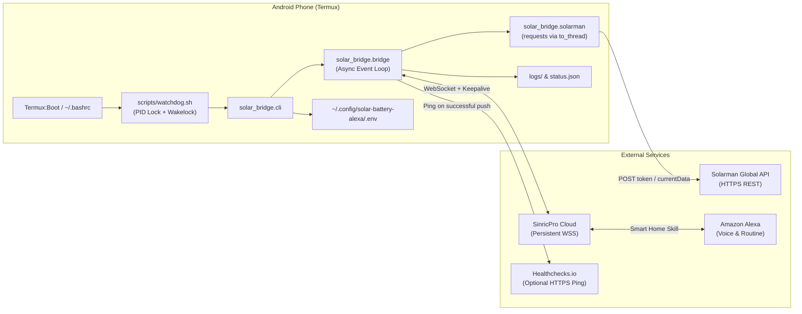
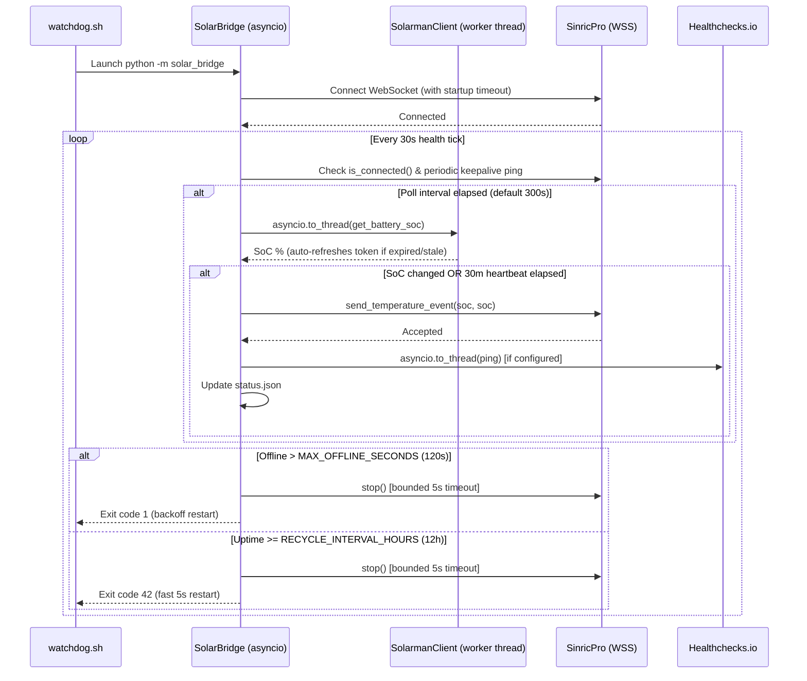

# System Design: Solar Battery Alexa Bridge

## 1. Overview & Goals

**Solar Battery Alexa Bridge** is a lightweight, zero-cost Python service that reads the real-time battery State of Charge (SoC) from a Deye/Sunsynk inverter via the **Solarman Global API** and publishes it to **Amazon Alexa** through a virtual **SinricPro** Thermostat device.

### Design Goals
- **Always-on, low-power operation** on an Android phone running **Termux** (or any Linux host / Raspberry Pi).
- **Zero-cost cloud integration** using SinricPro's free tier + Alexa Routines.
- **Self-healing reliability** across Wi-Fi drops, router NAT timeouts, Android sleep, and Solarman token expirations.
- **Unattended auto-start** on phone reboot (`Termux:Boot`) and Termux launch (`~/.bashrc`), with duplicate-process protection.
- **Safe credential isolation** outside the git repository (`~/.config/solar-battery-alexa/.env`) with hashed Solarman password support.
- **Agent-friendly modularity & offline testability** with no import-time side effects and pure-Python runtime dependencies.

---

## 2. High-Level Architecture

---

## 3. Module & Script Breakdown

| Path | Responsibility |
| --- | --- |
| `src/solar_bridge/config.py` | Loads and validates `BridgeConfig` from `--env-file` / `SOLAR_BRIDGE_ENV`, `~/.config/solar-battery-alexa/.env`, or `./.env`. Supports `SOLARMAN_PASSWORD_HASH` (preferred) or `SOLARMAN_PASSWORD`. Zero import-time side effects. |
| `src/solar_bridge/solarman.py` | `SolarmanClient` manages token acquisition, proactive TTL refresh, and `B_left_cap1` SoC retrieval. Handles both HTTP `401`/`403` and HTTP `200` `{"success": false}` token expirations without logging secrets. |
| `src/solar_bridge/bridge.py` | Async runtime (`SolarBridge`) owning the SinricPro WebSocket lifecycle, non-blocking polling via `asyncio.to_thread`, change/heartbeat throttling, keepalive pings, fast offline exit, periodic clean recycle, and `status.json` updates. |
| `src/solar_bridge/cli.py` | CLI parser (`--env-file`, `--check-config`, `--dry-run`, `--once`, `--hash-password`, `--debug`), logging setup (console + rotating file), and exit-code mapping. |
| `src/battery_soc.py` | Backwards-compatible entrypoint shim forwarding to `solar_bridge.cli`. |
| `src/battery_test.py` | Interactive CLI simulator for manually testing SinricPro -> Alexa updates. |
| `scripts/watchdog.sh` | Termux-safe supervisor (`#!/usr/bin/env bash`): enforces single instance via PID lock, acquires `termux-wake-lock`, checks connectivity, restarts quickly after clean recycle (`exit 42`), and backs off on errors. |
| `scripts/setup_termux.sh` | Idempotent one-command Termux installer: installs runtime deps, initializes `~/.config/solar-battery-alexa/.env` (`chmod 600`), configures `~/.termux/boot/` and `~/.bashrc`, and launches the watchdog. |
| `scripts/start.sh` | Starts `watchdog.sh` in the background if not already running and prints the watchdog PID and log path. |
| `scripts/stop.sh` | Gracefully stops the running watchdog + bridge and releases `termux-wake-lock`. |

---

## 4. Data Flow & Runtime Lifecycle

### Exit Code Contract (`bridge.py` <-> `watchdog.sh`)

| Exit Code | Meaning | Watchdog Action |
| --- | --- | --- |
| `0` | Intentional stop (`SIGINT` / `SIGTERM` / `--once`) | Stop cleanly (do not restart) |
| `42` | Scheduled clean recycle (`RECYCLE_INTERVAL_HOURS`) | Wait 5s, restart immediately with fresh process/token/socket |
| Non-zero (other) | Startup error, extended SinricPro disconnect, or crash | Backoff (30s -> 60s -> 120s, capped at 300s) and restart once internet is reachable |

---

## 5. Failure Modes & Recovery Matrix

| Failure Mode | Why It Happened Previously | New Detection & Recovery |
| --- | --- | --- |
| **Solarman token expires with HTTP 200 `success: false`** | Only HTTP 401 triggered re-auth; script got stuck forever. | Detects HTTP `401`/`403`, JSON `success: false`, and token age >= `TOKEN_REFRESH_HOURS`; re-authenticates and retries once automatically. |
| **Slow Solarman HTTP blocks WebSocket heartbeat** | Synchronous `requests` ran on the `asyncio` loop (>10s ping timeout). | All `requests` calls execute inside `asyncio.to_thread(...)`, keeping the event loop responsive. |
| **Silent NAT/Wi-Fi WebSocket drop** | `sinricpro` pings every 5 min (15 min to notice), retries once, then gives up permanently; script waited 50 min to exit. | Active keepalive pings + 30s connection checks; exits after `MAX_OFFLINE_SECONDS` (default 120s) so watchdog spawns a clean WebSocket. |
| **Hanging shutdown on dead socket** | `sinric_task.cancel()` cancelled an already-finished task; `ws.close()` could hang. | Calls `await asyncio.wait_for(sinric.stop(), timeout=5)` with forced cleanup fallback if shutdown stalls. |
| **Long-lived session drift / memory or token staleness** | Process stayed up indefinitely without recycling. | Cleanly recycles every `RECYCLE_INTERVAL_HOURS` (default 12h) via exit code `42` (~5s reconnect window). |
| **Duplicate processes on Termux** | Opening new Termux sessions or boot hooks could start multiple copies. | `watchdog.sh` checks/locks `logs/watchdog.pid` before launching. |
| **Android killing Termux in background** | No automatic wakelock in script. | `watchdog.sh` invokes `termux-wake-lock` automatically when present (paired with disabling Android battery optimization for Termux & Termux:Boot). |

---

## 6. Termux Runtime & Security Model

- **Credentials location:** `~/.config/solar-battery-alexa/.env` (`chmod 700` dir, `chmod 600` file). Lives inside Termux's private Android app sandbox (`/data/data/com.termux/files/home`) and outside the git repo, surviving re-clones and preventing accidental commits.
- **No plaintext inverter password required:** Solarman only consumes the SHA-256 digest of the password, so `.env` can store `SOLARMAN_PASSWORD_HASH` exclusively.
- **Auto-start layers:**
  1. **On phone reboot:** `~/.termux/boot/start-solar-bridge.sh` (requires `Termux:Boot` from F-Droid; note Android Direct Boot requires first unlock if a screen lock PIN is set).
  2. **On Termux launch:** Idempotent guard in `~/.bashrc` starts `watchdog.sh` in the background only if no instance is already running.
- **Pure-Python runtime dependencies:** Only `requests`, `python-dotenv`, and `sinricpro` are required on the phone, avoiding C/Rust compilation failures on ARM Android.

---

## 7. Observability

- **Rotating bridge logs:** `logs/bridge.log` (rotating file handler, capped size/backups so phone storage never fills up).
- **Watchdog logs:** `logs/watchdog.log` (tracks launches, exit codes, internet outages, and restarts).
- **Machine-readable status snapshot:** `status.json` updated atomically on state changes with:
  - `connected` (bool)
  - `last_soc` (float or null)
  - `last_poll_at`, `last_push_at`, `started_at` (ISO-8601 timestamps)
  - `last_error` (string or null, sanitized)
- **External dead-man's switch:** Optional `HEALTHCHECKS_URL` pinged on every successful SinricPro push so Healthchecks.io alerts if the phone goes completely offline.

---

## 8. Architecture Decision Records (ADRs)

Detailed rationale and tradeoffs are documented in `docs/adr/`:
- [`0001-persistent-websocket-with-recycle.md`](adr/0001-persistent-websocket-with-recycle.md) — Persistent SinricPro WebSocket + periodic clean recycle vs. cron/one-shot.
- [`0002-external-config-and-password-hash.md`](adr/0002-external-config-and-password-hash.md) — `~/.config/solar-battery-alexa/.env` + `SOLARMAN_PASSWORD_HASH`.
- [`0003-termux-autostart-and-watchdog.md`](adr/0003-termux-autostart-and-watchdog.md) — `Termux:Boot`, `~/.bashrc` guard, PID-locked `watchdog.sh`, and wakelock.
- [`0004-modular-agent-friendly-architecture.md`](adr/0004-modular-agent-friendly-architecture.md) — `src/solar_bridge/` package layout, zero import-time side effects, `pyright`/`ruff`/`pytest`, and offline test suite.
